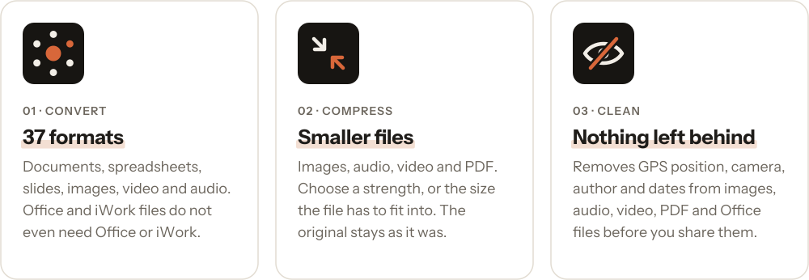
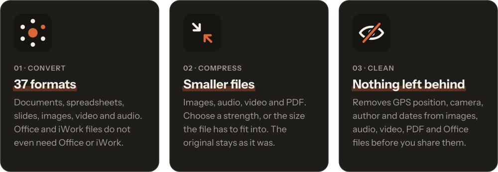

<p align="center">
  <a href="#install"></a>
  &nbsp;&nbsp;
  <a href="#what-it-does"></a>
</p>

<br>


<br>

<a id="what-it-does"></a>


<p>
  <a href="docs/brand/cards-light.svg#gh-light-mode-only"><picture><source media="(max-width: 640px)" srcset="docs/brand/cards-narrow-light.svg"></picture></a>
  <a href="docs/brand/cards-dark.svg#gh-dark-mode-only"><picture><source media="(max-width: 640px)" srcset="docs/brand/cards-narrow-dark.svg"></picture></a>
</p>

Originals are never changed, and a new file never replaces an existing one.

<details>
<summary><b>See all 37 formats</b></summary>

<br>

| Family | Formats |
| --- | --- |
| Documents | TXT, Markdown, RTF, HTML, DOCX, DOC (read), ODT, EPUB, Pages, PDF |
| Spreadsheets | XLSX, CSV, TSV, Numbers (read) |
| Presentations | PPTX, Keynote (read) |
| Images | JPEG, PNG, HEIC, WebP, AVIF, TIFF, GIF, BMP |
| Video | MP4, MOV, M4V, MKV, WebM, AVI (read) |
| Audio | MP3, M4A, WAV, FLAC, OGG, Opus, AIFF |

Office and iWork files do not need Office or iWork to be installed. Scanned PDFs and images are read with on-device text recognition. HEIC and AVIF are offered only where macOS can write them, and AVIF may be missing on older systems and on Intel.

</details>

<br>

<a id="install"></a>


You need a Mac with **macOS 15 or later**, with Apple Silicon or Intel. To check yours, open the Apple menu and choose **About This Mac**. MediaShift is not in the Mac App Store or in Homebrew.

### Download the app

For almost everyone. No coding, and no Terminal.

> **Not available yet.** The first download will appear on the [Releases page](https://github.com/rightform/mediashift/releases) once Apple has checked the app, a step called notarization. Until then, build it yourself below.

1. On the [Releases page](https://github.com/rightform/mediashift/releases), under **Assets** of the newest version, click the file that ends in `.dmg`.
2. Open the downloaded file and drag **MediaShift** onto **Applications**.
3. Close the window, and in the Finder sidebar click the eject symbol next to **MediaShift**. You can now delete the `.dmg` file.
4. Open **MediaShift** from your Applications folder. If macOS asks whether you are sure, click **Open**.

### Build it yourself

This works today, and you do not need to know how to code. You paste a few lines into Terminal, an app that comes with every Mac, and wait. On an M4 MacBook the building took about 6 minutes, and it takes longer on older Macs. It uses about 2 GB of disk space, which you can get back afterwards.

<details>
<summary><b>Show the steps</b></summary>

<br>

1. **Open Terminal.** Press Command and Space together, type `Terminal` and press Return.

2. **Install Apple's free developer tools.** Paste this line and press Return. In the window that appears, click **Install** and wait until it finishes. If Terminal says they are already installed, just go on.

    ```bash
    xcode-select --install
    ```

3. **Get MediaShift.** Paste these lines one at a time, pressing Return after each.

    ```bash
    git clone https://github.com/rightform/mediashift.git
    ```

    ```bash
    cd mediashift
    ```

4. **Build the app.** Paste the first line and wait until Terminal lets you type again, then do the same with the second. Text scrolling past is normal. The second one is done when the last line ends in `MediaShift.app`.

    ```bash
    make ffmpeg
    ```

    ```bash
    make app
    ```

5. **Move it to your Applications folder and open it.** An app you build on your own Mac opens without any warning.

    ```bash
    ditto ~/Library/Caches/MediaShift/dist/MediaShift.app /Applications/MediaShift.app
    ```

    ```bash
    open /Applications/MediaShift.app
    ```

**If something goes wrong:**

- *"You have not agreed to the Xcode license":* run the line below. Terminal asks for your Mac password. Nothing shows while you type it, which is normal. Press Return when done, then try the step again.

    ```bash
    sudo xcodebuild -license accept
    ```

- *An error that mentions the SDK or the Swift version:* your tools are too old. Update macOS and the developer tools in System Settings, under General, Software Update, then try the step again.

</details>

### After installing

**MediaShift has no window and no icon in the Dock.** It lives in the menu bar at the top of your screen, on the right, as a small dot circled by six smaller ones.

To try it, start dragging any file in the Finder and tap Shift. To have MediaShift start with your Mac, click its icon, then the **...** button, then **Settings**, and turn on **Open at login**.

<details>
<summary><b>I cannot see the icon</b></summary>

<br>

Your menu bar may be full. On a MacBook with a notch, icons that do not fit are hidden without any message, so quit another menu bar app and look again. On macOS 26 and later, also check that MediaShift is allowed in System Settings, under **Menu Bar**.

</details>

<details>
<summary><b>macOS says it cannot verify the app</b></summary>

<br>

macOS shows this for a downloaded copy that Apple has not checked yet. It stops once downloads are notarized, and it never appears for a copy you built yourself. Only continue if the copy came from this project's [Releases page](https://github.com/rightform/mediashift/releases).

1. Click **Done** in the message. Do not move the app to the Trash.
2. Open System Settings, then **Privacy & Security**, and scroll down to the **Security** section.
3. Next to the message about MediaShift, click **Open Anyway**, then confirm with your password.

If the button is not there, try opening the app once more and look again. The exact wording can differ between versions of macOS.

</details>

<details>
<summary><b>Updating and removing</b></summary>

<br>

**To update,** quit MediaShift by clicking its icon, then the **...** button, then **Quit**. Then install the new version the same way, and your settings stay as they are. If you built it yourself, go into the `mediashift` folder in Terminal, run `git pull`, and repeat steps 4 and 5.

**To remove it,** turn off **Open at login** if you turned it on, quit MediaShift, and drag it from your Applications folder to the Trash. If you built it yourself, you can also delete the `mediashift` folder in your home folder, and get the disk space back with this line:

```bash
rm -rf ~/Library/Caches/MediaShift
```

</details>

<br>


**The wheel.** Tap Shift at any moment while dragging files from anywhere. Drop on a format, or back in the middle to cancel.

**The menu bar.** Drop files on the icon, or open it and choose files. Everything the wheel does is there too, from the keyboard, with progress and history.

**Settings.** Six pages, and you can leave all of them as they are.

<p align="center">
  
  
</p>

<details>
<summary><b>What you can change</b></summary>

<br>

- **General:** open at login, how many conversions run at once, and what happens when they finish.
- **Wheel:** the key that opens it (Shift, Control, Option or Command), haptic feedback, and which formats appear on it.
- **Output:** where results go, what is added to their names, metadata removal, compression strength and a size limit.
- **Images:** quality and largest size.
- **Video & Audio:** codec, quality, largest resolution, GIF size and frame rate, and audio bitrate.
- **Documents:** PDF page size, the resolution of pages turned into images, and text recognition for scans.

</details>

<details>
<summary><b>Good to know</b></summary>

<br>

- The document model keeps structure and common text styling, such as headings, lists, tables, images, links, bold and colour. It does not keep page layout, so a converted file will not match a designed original exactly.
- RTF and ODT output carry text and tables, but images are not preserved.
- PDF to text formats recovers text and headings, not layout.
- The first text recognition after installing takes about 25 seconds while macOS prepares its model. After that it is immediate.
- Written Pages files hold text and heading styles, so images and tables become text.
- Intel support is new and less tested than Apple Silicon. Video encoding on Intel Macs is slower too.
- The wheel uses Liquid Glass on macOS 26 and later, and a system material on macOS 15.

</details>

<details>
<summary><b>The command line</b></summary>

<br>

The tool ships inside the app. To use it from anywhere, link it once:

```bash
sudo ln -s /Applications/MediaShift.app/Contents/Helpers/mediashift /usr/local/bin/mediashift
```

Then:

```bash
mediashift report.docx --to pdf
```

```bash
mediashift holiday/*.heic --to jpeg --out converted
```

```bash
mediashift talk.mov --compress strong
```

```bash
mediashift photo.jpg --strip-metadata
```

</details>

<details>
<summary><b>For developers</b></summary>

<br>

The app runs on macOS 15 or later, on Apple Silicon and Intel. Building it takes the macOS 26 SDK or newer, from Xcode or just the Command Line Tools.

```bash
make ffmpeg
```

```bash
make test
```

```bash
make app
```

```bash
make dmg
```

`make ffmpeg` builds the media engine from pinned, verified sources and is needed once. Without it, the tests that depend on it are skipped. `make app` and `make dmg` print the location of what they made. The disk image holds the app and a shortcut to Applications, and it is not signed or notarized yet.

Both build for Apple Silicon and Intel in one go. `FFMPEG_ARCHS=arm64 make ffmpeg` and `APP_ARCHS=arm64 make app` build one architecture only, which is much quicker while developing.

```
MediaShiftApp     menu bar, wheel, settings (SwiftUI and AppKit)
mediashift        command line tool
      \           /
      ConversionKit       one entry point, the catalog of what converts to what
      /     |      \
DocumentEngine  OfficeFormats  MediaEngine
      \     |      /
      ConversionCore      formats, the document model, errors
```

Documents do not convert to each other directly. Every reader produces a `RichDocument`, and every writer consumes one, so a new format means one reader or one writer rather than a converter for every other format. PDFs of Office and iWork files are the exception: they come from the system's own Quick Look renderer, which knows their fonts and layout, with the shared model as a fallback.

Images go through ImageIO, and audio and video through ffmpeg with the Mac's hardware encoders.

</details>

<br>


rightform designs and builds digital solutions fitted to a specific need: websites, shops, automations and AI tools. Got a question, an idea, or a project of your own? Write to me.

<p>
  <a href="mailto:hej@rightform.pl"></a>
</p>

<br>

<p>
  <a href="https://rightform.pl/#gh-light-mode-only"></a>
  <a href="https://rightform.pl/#gh-dark-mode-only"></a>
</p>

[hej@rightform.pl](mailto:hej@rightform.pl) · [rightform.pl](https://rightform.pl)

<sub>[MIT license](LICENSE). The bundled ffmpeg is built without GPL components and is licensed under the LGPL, see [THIRD-PARTY-NOTICES](THIRD-PARTY-NOTICES.md). The rightform name and logo belong to rightform Aleksander Jagusiak and are not covered by the MIT license.</sub>
